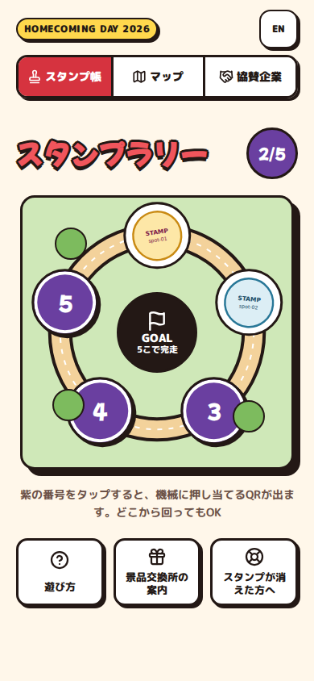
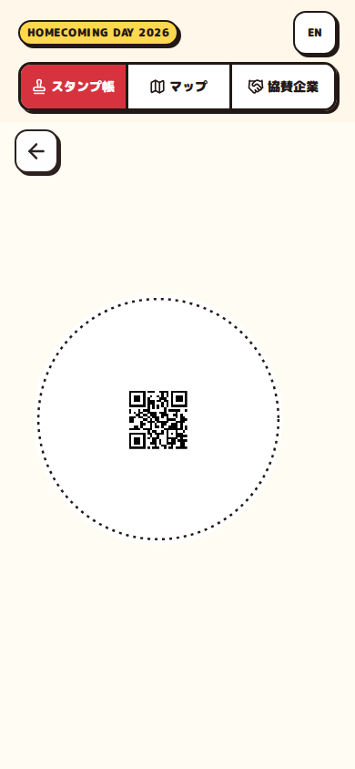
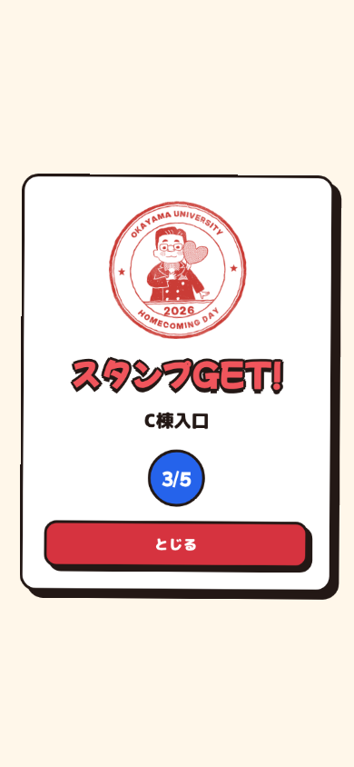
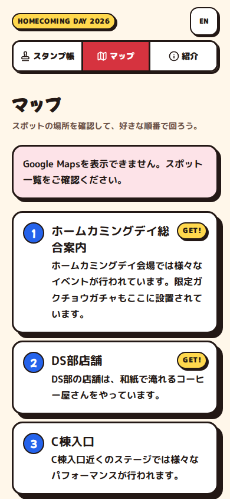
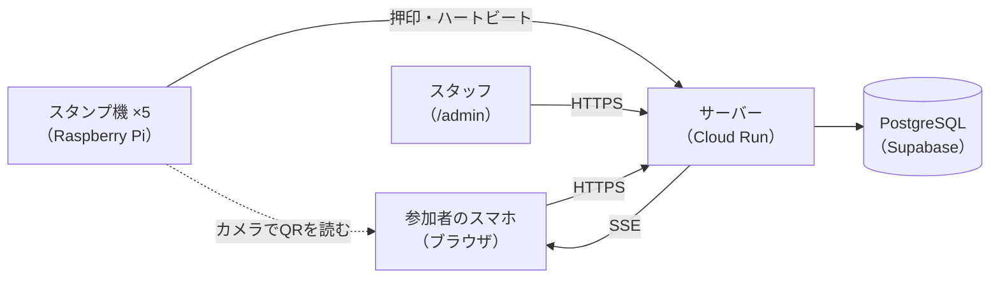

# 岡山大学ホームカミングデイ デジタルスタンプラリー 2026

2026年10月31日の岡山大学ホームカミングデイで使った、デジタルスタンプラリーのソースコードと設計文書です。
参加者はスマホのブラウザでQRコードを出し、会場5か所のスタンプ機（Raspberry Pi）にかざしてスタンプを集めます。
アプリのインストールや会員登録は要りません。

> A digital stamp rally used at Okayama University Homecoming Day on October 31, 2026.
> Participants show a QR code in their phone browser to a Raspberry Pi stamp machine at each of five spots.
> The source code is MIT-licensed; images, fonts and documents are not (see [ライセンス](#ライセンス)). All documents are in Japanese.

| スタンプ帳 | QRの表示 | 押印 | マップ |
| --- | --- | --- | --- |
|  |  |  |  |

## 当日の結果

一般開放（10:00）から終了までの集計です。参加者はブラウザ単位で数え、開放前の試験用のセッションと、
リンクのプレビューなどのボットは除いています。

| 項目 | 数 |
| --- | --- |
| 参加者 | 359人 |
| 1つ以上押印した人 | 242人 |
| 5か所すべて集めた人（完走） | 137人 |
| 押印の合計 | 887件 |
| 完走までにかかった時間（中央値） | 36分 |

## しくみ



1. 参加者がページを開くと、サーバーがセッションを発行してCookieに保存します。スタンプ帳の空いた丸をタップすると、押印用のQRが出ます
2. スタンプ機は常にカメラでQRを探し、読み取った値をサーバーへ送ります。押印を書き込む経路はこれだけで、スマホとスタンプ機は直接通信しません
3. サーバーは押印を記録してSSEでスマホへ知らせ、スマホは押印の演出を出して受信確認を返します。SSEが切れていても、定期的な問い合わせで反映されます
4. スタンプ機がサーバーに届かないときは、押印をファイルに保存しておき、つながってから送り直します
5. スタッフは `/admin` のダッシュボードで、スタンプ機の稼働状況と参加状況を見ます

## 技術構成

| 部分 | 使ったもの |
| --- | --- |
| 参加者向けWebアプリ・ダッシュボード | TypeScript、React、Vite |
| サーバー | TypeScript、Node.js、Hono、Drizzle ORM。Google Cloud Run で動かし、Webのビルド成果物も同じサービスから配信 |
| データベース | Supabase（PostgreSQL としてだけ使い、サーバーからのみ接続） |
| APIの型 | Zod のスキーマを `shared/` に置き、サーバーとWebの両方から参照 |
| スタンプ機 | Python、OpenCV、Picamera2。Raspberry Pi Zero 2 WH、Camera Module 3、GC9A01A 円形液晶（240×240） |
| テスト | Vitest、Playwright、pytest |

## ディレクトリ

| パス | 内容 |
| --- | --- |
| [`shared/`](shared/) | APIのZodスキーマと型 |
| [`server/`](server/) | サーバー（API、SSE、DB、イベント後の書き出し `db:export`） |
| [`web/`](web/) | 参加者向けWebアプリと、スタッフ用ダッシュボード `/admin` |
| [`device/`](device/) | スタンプ機の制御ソフト（独立したPythonプロジェクト） |
| [`supabase/`](supabase/) | ローカルのPostgreSQL（Supabase CLI）の設定 |
| [`reference/`](reference/) | 試作時のコード（QRの読み取りと液晶の表示、通信の遅延の計測）。参考として残し、手を加えていない |
| [`docs/`](docs/) | 仕様書、画面設計、完了条件、運用の手順書 |
| `Dockerfile`、`cloudbuild.yaml` | WebとサーバーをまとめたCloud Run用のイメージ |
| [`AGENTS.md`](AGENTS.md) | 開発に使ったAIコーディングエージェント向けの作業規則 |

## 文書

[`docs/README.md`](docs/README.md) に読む順番があります。

- [`docs/spec.md`](docs/spec.md) — 仕様書。なぜその設計にしたかは12章「決定事項の記録」にあります
- [`docs/design.md`](docs/design.md) — 画面設計
- [`docs/goals/`](docs/goals/) — 工程ごとの完了条件
- [`docs/deploy.md`](docs/deploy.md)、[`docs/device.md`](docs/device.md)、[`docs/data.md`](docs/data.md)、[`docs/remaining-tasks.md`](docs/remaining-tasks.md) — イベントに向けて書いた運用の手順と記録

## ローカルで動かす

Node.js 22、pnpm 10、Python 3.12以上を使います。

```sh
pnpm install
pnpm test        # shared・server・web の単体テスト
pnpm lint
pnpm typecheck
```

スタンプ機の制御ソフトは、開発PCではダミーのカメラと液晶で動きます。

```sh
cd device
python3 -m venv .venv
.venv/bin/pip install -e '.[dev]'
.venv/bin/pytest
.venv/bin/ruff check .
.venv/bin/mypy hcd_stamp_device
```

サーバーの起動、ローカルのPostgreSQLを使う結合テスト、画面の確認、結合E2Eの準備は、
各ディレクトリのREADME（[server](server/README.md)、[web](web/README.md)、[device](device/README.md)、[shared](shared/README.md)）にあります。

> [!NOTE]
> イベントの日時（一般開放 2026年10月31日10:00、参加者画面の終了 15:30、押印の受け付け 16:00まで）は
> [`server/src/config.ts`](server/src/config.ts) に固定してあります。そのため今サーバーを起動すると、参加者画面は終了画面になり、
> 押印も受け付けません。参加者画面はローカル用の環境変数 `PARTICIPANT_OPEN_AT`・`PARTICIPANT_CLOSE_AT` で開けますが、
> 押印の受け付け期限は変えられません。結合E2E（`pnpm test:e2e`）のうち、押印と開放前の解除を確かめる2件も、
> この期限を過ぎた今は失敗します。

## ライセンス

ソースコードは [MIT License](LICENSE) です。次はMIT Licenseの対象外です。

- 画像。権利は各権利者にあり、転載・再利用はできません
  - スタンプの絵柄（[`web/public/images/stamps/`](web/public/images/stamps/)、[`device/hcd_stamp_device/assets/stamps/`](device/hcd_stamp_device/assets/stamps/)）
  - 紹介画面の写真（[`web/public/images/about/`](web/public/images/about/)）
  - スクリーンショット（[`docs/screenshots/`](docs/screenshots/)。スタンプの絵柄を含む）
- フォントの IPAexゴシック（[`device/hcd_stamp_device/assets/fonts/`](device/hcd_stamp_device/assets/fonts/)）。
  同じフォルダの IPAフォントライセンスv1.0 に従います
- [`docs/`](docs/) の文書
