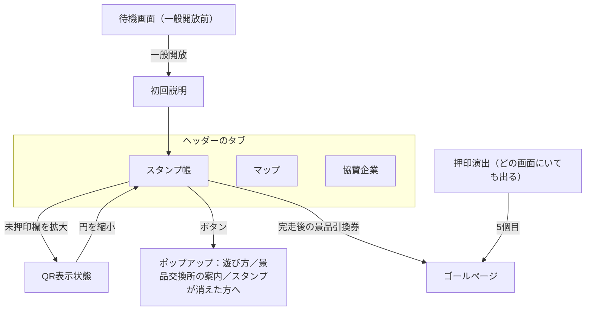

# デザインガイド（Webアプリ・v1.8正式版）

対象は web/ の参加者向け画面。スタッフ用ダッシュボードはトークンだけ共通にし、装飾は最小限にする。確定した設計差分は本書へ統合済みで、本書だけを設計の正本とする。

## 0. 方向性

昨年のポスターの配色（クリーム地、コーラル、焦げ茶、黄、紫）を、**ネオブルータリズム**で組み直す。太い枠線、ぼかしのない影、フラットな色面、太い丸ゴシック。

- **レイアウト**は、縦長1枚のスタンプ台紙とする。刷られた見出し、案内文、5つの押印欄、切り取り線、景品引換券の順に並べる
- 5つの丸い押印欄は上段3つ・下段2つで中央寄せにし、道、線、矢印では結ばない。番号はスポット識別だけに使い、訪問順を表さない
- 太い枠線とぼかしのない影は台紙の外周と台紙外の操作部品に使う。台紙内の印刷要素には影を付けない
- スタンプ帳画面では緑の地面、黄土色の道、木の装飾を使わない。ネオブルータリズムの配色と太い丸ゴシックは維持する

### 画面の構成

- 画面の切り替えは**ヘッダーのタブ**で行う。タブは「スタンプ帳」「マップ」「協賛企業」の3つ
- スタンプ帳の未押印欄をタップすると、**同じ丸い押印欄が画面中央へ拡大**し、その円内にQRを表示する。このときヘッダーとタブは隠す
- 「遊び方」「景品交換所の案内」「スタンプが消えた方へ」は、スタンプ帳のボタンから**ポップアップ**で開く
- **ゴールページ**は完走後に景品引換券の「ゴールへ」から開く。5個目の押印時は自動で遷移する
- 画面の下端に固定したナビゲーションは置かない
- 一般開放（10月31日10:00）より前は**待機画面**だけを出し、ほかの画面へは進めない（4-10）



## 1. 原則

1. **押す体験を画面でも。** タップできる要素は原則として影をつけて浮かせ、押すと影のぶん沈む。台紙内の未押印欄だけは印刷物に見せるため影を付けず、押下時に内側をpinkで塗る
2. **屋外と幅広い年齢層。** 本文は16px、文字のコントラストはWCAG AA（4.5:1、24px以上の太字は3:1）以上、タップ領域は48×48px以上
3. **色は面で塗る。** グラデーション、ぼかした影、半透明の重ね（すりガラス風など）は使わない。例外はポップアップの背景を暗くする1か所だけ
4. **装飾は控えめに。** きらめき（4点星）は1画面3つまで。情報の上に重ねない
5. **英語でも崩れない。** 文字を含む要素に固定幅を与えない。英語は日本語より1.5倍ほど長くなる前提で折り返しを許す

## 2. デザイントークン

`web/src/styles/tokens.css` に CSS 変数として定義する。色・枠線・影・角丸・フォントは**この変数だけを使い**、コンポーネントやページに色コードを直書きしない。

```css
:root {
  color-scheme: light;

  /* 色 */
  --color-bg: #FFF7EA;          /* 画面の地 */
  --color-surface: #FFFFFF;     /* カード */
  --color-ink: #231815;         /* 枠線・文字・影 */
  --color-muted: #6B5147;       /* 補足文字（地の上で7:1） */
  --color-coral: #F0555C;       /* 大見出し専用。必ずインクの縁取りと組み合わせる */
  --color-coral-strong: #D6333F;/* 白文字を載せる面（選択中のタブ、ボタン、タグ） */
  --color-purple: #6A3FA0;      /* 未押印の番号マーカー、手順2 */
  --color-purple-soft: #F4EEFB; /* QR目印の円の内側 */
  --color-yellow: #FFD84D;      /* チップ、強調、完走 */
  --color-pink: #FDE3E8;        /* 案内の帯 */
  --color-paper: #FFFCF3;       /* スタンプ台紙 */
  --color-watermark-line: #F1DAD4; /* 未押印欄の下絵の線 */
  --color-watermark-fill: #F4E4DF; /* 未押印欄の下絵の塗り */
  --color-board: #CFE8B8;       /* スタンプ帳の地面 */
  --color-road: #F3D29B;        /* 道 */
  --color-tree: #7DBB5E;        /* 木の飾り */
  --color-stamp: #E4414B;       /* 仮スタンプの色 */
  --color-backdrop: rgb(35 24 21 / 0.55); /* ポップアップの背景（唯一の半透明） */

  /* 枠線と影（影はぼかさない） */
  --border: 3px solid var(--color-ink);
  --border-thin: 2px solid var(--color-ink);
  --shadow-sm: 3px 3px 0 var(--color-ink);
  --shadow-md: 5px 5px 0 var(--color-ink);
  --shadow-lg: 8px 8px 0 var(--color-ink);
  --border-status-healthy: 6px solid var(--color-tree);
  --border-status-alert: 6px solid var(--color-coral-strong);
  --border-none: 0;

  /* 角丸 */
  --radius-card: 18px;
  --radius-button: 14px;
  --radius-pill: 999px;

  /* 余白（4の倍数） */
  --space-1: 4px;  --space-2: 8px;  --space-3: 12px; --space-4: 16px;
  --space-5: 20px; --space-6: 24px; --space-8: 32px; --space-10: 40px;

  /* 文字 */
  --font-display: 'Mochiy Pop One', 'M PLUS Rounded 1c', 'Hiragino Maru Gothic ProN', sans-serif;
  --font-body: 'M PLUS Rounded 1c', 'Hiragino Maru Gothic ProN', 'Yu Gothic', sans-serif;

  /* 動き */
  --duration-press: 80ms;
  --duration-popup: 160ms;
  --duration-qr-reveal: 40ms;
  --duration-stamp: 280ms;
  --ease-stamp: cubic-bezier(0.2, 1.4, 0.4, 1);
}
```

フォントは Google Fonts から読み込む。M PLUS Rounded 1c は 500・700・800・900、Mochiy Pop One は 400。

### 文字の大きさ

| 用途 | フォント | 大きさ / 行間 / 太さ |
| --- | --- | --- |
| 画面タイトル | display | 34px / 1.15 |
| 大見出し（ゴールなど） | display | 44〜64px / 1.1 |
| ポップアップの見出し | display | 22px / 1.3 |
| 小見出し | body | 20px / 1.4 / 900 |
| 本文 | body | 16px / 1.7 / 700 |
| 補足 | body | 14px / 1.6 / 700 |
| タブ・ボタン | body | 14〜16px / 1 / 900 |
| 最小（ラベル） | body | 12px / 1.4 / 800。これより小さくしない |

### 縁取り見出し

コーラルの大見出しは、インクで縁取りし、下に影を落とす。`paint-order` に対応しないブラウザがあるため、`text-shadow` の8方向と下方向で表現する。

```css
.outlined {
  font-family: var(--font-display);
  color: var(--color-coral);
  text-shadow:
    3px 0 0 var(--color-ink), -3px 0 0 var(--color-ink),
    0 3px 0 var(--color-ink), 0 -3px 0 var(--color-ink),
    2px 2px 0 var(--color-ink), -2px 2px 0 var(--color-ink),
    2px -2px 0 var(--color-ink), -2px -2px 0 var(--color-ink),
    0 5px 0 var(--color-ink);
}
```

## 3. コンポーネント

`web/src/components/ui/` に置く。スタイルは CSS Modules とトークンで書き、UIライブラリは使わない。アイコンは lucide-react（線幅 2.25、18〜28px）。絵文字は使わない。

| コンポーネント | 見た目と振る舞い |
| --- | --- |
| HeaderTabs | 3つのタブを横に等分した一体のバー。外枠 `--border`、`--shadow-sm`、角丸 button。タブの間はインクの3px の仕切り。選択中は背景 coral-strong・白文字、それ以外は surface・インク文字。各タブはアイコン（18px）と文字（14px / 900）、高さ48px以上。`<nav>` の中のリンクとして作り、選択中に `aria-current="page"` |
| Button（primary） | 背景 coral-strong、白文字、`--border`、`--shadow-md`、角丸 button、高さ52px以上。押すと `translate(5px, 5px)` で影が0になる |
| Button（secondary） | 背景 surface、インク文字。そのほかは primary と同じ |
| IconButton | 48×48px、surface、`--border-thin`、`--shadow-sm`。アイコンのみのときは `aria-label` 必須 |
| InfoTile | スタンプ帳の3つの案内ボタン。surface、`--border`、`--shadow-sm`、角丸 button、高さ84px。上にアイコン（24px）、下に文字（13px / 800、最大2行）。押すと沈み、ポップアップを開く |
| Popup | `<dialog>` を `showModal()` で開く。背景は `--color-backdrop`（ぼかさない）。本体は surface、`--border`、`--shadow-lg`、角丸 card、幅は画面から左右16px を引いた値（最大400px）、高さは最大で画面の80%、本文だけスクロール。上に見出しと閉じるの IconButton、下に Button（secondary）「とじる」。Esc と背景のタップでも閉じ、閉じたら開いたボタンにフォーカスを戻す。開くときは `scale(0.96) → 1` を `--duration-popup` で |
| Chip | 背景 yellow（または surface）、`--border-thin`、`--shadow-sm`、角丸 pill、12〜13px / 900 |
| Tag | 背景 coral-strong、白文字、`--border-thin`、少し傾ける（-4°）。「ここでやること」などの見出し札 |
| Card | 背景 surface、`--border`、`--shadow-lg`、角丸 card |
| BoardCard | Card の地面版。背景board。ゴールページの道の帯など、台紙以外で使う |
| Band | 背景 pink、`--border`、`--shadow-md`、角丸 card。案内の帯 |
| NumberBadge | 30px の円、白文字、`--border-thin`。手順の番号。1と3は coral-strong、2は purple |
| SpotMarker | マップ専用の地点表示。purple の円に白い番号（display 24px）。白の4px の内枠、インクの3px の外枠 |
| StampSlot | ゴールページとマップで使う押印済み表示。surface の円に `--border`、中に StampImage を85%の大きさで。影なし、タップしない |
| StampImage | `/images/stamps/{spotId}.png` を表示。無いときは仮画像（二重円＋星＋「SPOT 0n」、色は stamp）。傾きはスポットごとに固定（spot-01から順に -8°, 6°, -4°, 8°, -6°） |
| ProgressBadge | 64px の円、背景 purple、`--border`。「2/5」を白で。タップしないので影なし |
| StampCard | 1枚の台紙全体。paper、`--border`、`--shadow-lg`、角丸card、最大幅350px。見出し、案内、上段3・下段2の押印欄、景品引換券を含む |
| CardStampSlot | 直径84px基準の押印欄。SVGの点線円（2.5px、`stroke-dasharray: 3 5`）、左上の番号バッジ、円下のスポット名。未押印だけbuttonとし、押印済みはStampImageを約112%で重ねる |
| PrizeStub | 台紙下部の景品引換券。上端は切り取り線。未完走は残数を表示して操作不可、完走後はyellowになり「ゴールへ」ボタンを表示する |
| SponsorCard | 協賛企業1社分。surface、`--border`、`--shadow-sm`、角丸 card、内側12px。上にロゴ枠（背景は白、縦横比3:2、ロゴは縦横比を保って収める、最小の高さ64px）、下に企業名（14px / 800）と紹介文（13px、muted、最大3行）。リンクがあればカード全体を外部リンクにし、右上に外部リンクのアイコン、押すと沈む。リンクが無ければ影なし |
| Sparkle | 4点星のSVG。yellow・coral・purple のいずれか。装飾なので `aria-hidden` |
| SpeechBubble | coral-strong の吹き出し、白文字、`--border-thin`、しっぽ付き。QR表示の「ここ!」 |
| CropMarks | 押印欄の四隅のL字。インク、線幅5px、長さ28px |

共通の振る舞い:

- 押したとき（`:active`）は影のぶん沈み、影が消える。時間は `--duration-press`
- キーボード操作時は `:focus-visible` に `outline: 3px solid var(--color-purple); outline-offset: 3px`
- `prefers-reduced-motion: reduce` のときは、沈む動き、ポップアップの拡大、スタンプの登場の動きを止める

## 4. 画面

幅は 360〜430px を想定し、中央寄せで最大幅 430px。左右の余白は20px。上下はセーフエリアを空ける。背景は bg。

### 4-0. 共通ヘッダー

スタンプ帳・マップ・協賛企業・ゴールページで表示する。上端に固定（`position: sticky`）し、背景は bg。

1. 1段目: 左に Chip「HOMECOMING DAY 2026」、右に言語切り替えの IconButton（「EN」／「日本語」）
2. 2段目: HeaderTabs。文言は日本語「スタンプ帳」「マップ」「協賛企業」、英語「Stamps」「Map」「Sponsors」。アイコンは順に stamp、map、handshake
3. 内容がヘッダーの下に潜るほどスクロールしたら、ヘッダーの下端に `--border` を出す

ゴールページではスタンプ帳のタブを選択中として扱う。

### 4-1. 電子スタンプ帳（1枚の台紙）

共通ヘッダーの下に、上から順に配置する。画面外側の「スタンプラリー」見出しと「0/5」形式の進捗は置かない。

1. **StampCard。** 幅100%、最大350px。右下の影、左右の切り欠き、番号バッジ、スタンプ画像を含めて画面内へ収める
   - 刷られた見出し: 左に「STAMP RALLY CARD」と「スタンプ台紙」、右に「岡山大学／ホームカミングデイ」
   - 案内文: 「空いている丸をタップして、スタンプ機を押し当ててね。どの順番でもOK。」
   - 押印欄: CardStampSlotを上段3つ・下段2つ。DOM順とフォーカス順はスポット1〜5。円下のスポット名は最大2行
   - 景品引換券: 上端に切り取り線と装飾の切り欠き。未完走は残数、完走後は「COMPLETE!」と「ゴールへ」を表示
2. **案内ボタン。** InfoTileを3つ横に等分して並べる（間は12px）。左から:
   - 「遊び方」（アイコン circle-help）
   - 「景品交換所の案内」（アイコン gift）
   - 「スタンプが消えた方へ」（アイコン life-buoy）
   英語は「How to play」「Prizes」「Lost stamps?」

押印欄は画面幅に応じて列間隔10→6px、列幅100→92px、円84→76pxの順に縮め、円は72px未満にしない。幅320・360・390・430pxで上段3・下段2を維持し、横スクロールを発生させない。未押印だけフォーカス可能とし、装飾は読み上げ対象から外す。

### 4-2. QR表示状態（押印欄の直接ズーム）

タップしたCardStampSlotの画面上の中心と直径を起点に、同じ円を画面中央へ連続的に拡大する。別のCardや画面が突然現れたように見せない。拡大の前半で下絵、文言、番号、スポット名を消し、円の内径が120px以上になってからQRを現す。

- 拡大後の円は `min(calc(100vw - 32px), calc(100dvh - 160px), 320px)`。真円、surface、SVGの点線（2.5px、`3 5`）を維持し、新しい影や外枠を加えない
- 画面全体はpaperとし、共通ヘッダー、タブ、台紙の他要素を画面外へ移して操作不能にする。QR表示中はページをスクロールさせない
- QR本体は **75×75 CSSピクセル**、誤り訂正レベルM、白い余白12px。ズーム中も拡大、縮小、変形、回転をしない
- どの押印欄から開いてもQR値は同じ。拡大状態ではスポット名、番号、特定のスタンプ画像を表示しない
- 見出し、説明文、手順、Chip、Tag、SpeechBubble、CropMarks、独立したQR用CardやBandは表示しない
- 戻るアイコンは48×48px以上で円外に置き、QRの白い余白から96px以上離す。`aria-label` は「スタンプ台紙にもどる」／「Back to stamp card」
- 画面上の戻る、ブラウザの戻る、Escで、QRを消しながら同じ経路・時間で元の円へ縮小する。未押印なら元の欄、押印済みならStampCard見出しへフォーカスを戻す
- ズームは `--duration-popup` 基準で最大300ms。`prefers-reduced-motion: reduce` とアニメーションAPI非対応時は即時に拡大状態へ切り替える
- 幅320・360・390・430px、縦横両向きで、円、QR、戻る操作をセーフエリア内に収め、スクロールを発生させない

### 4-3. 説明のポップアップ

スタンプ帳の InfoTile から Popup で開く。文言は確定するまでサンプル（spec 4-6）で、翻訳ファイルに置く。以下は文案。

**遊び方**

- 見出し「遊び方」
- NumberBadge 付きの3手順: 「1 スタンプ台紙の空いている丸をタップしてQRを出す」「2 スポットにあるスタンプ機を、QRに押し当てる」「3 機械の画面に絵柄が出たらスタンプGET」
- 補足: 「5つのスポットを、どの順番で回ってもかまいません。5つ集めるとゴールです」

**景品交換所の案内**

- 見出し「景品交換所の案内」
- ［景品交換所の名称］、［場所］、［受付時間］を、ラベル（12px、muted）と値（16px）の組で縦に並べる
- 補足: 「5つ集めたら、ゴールページをスタッフに見せてください」

**スタンプが消えた方へ**

- 見出し「スタンプが消えてしまった方へ」
- 本文: 「スタンプは、このスタンプラリーを開いたブラウザに保存されています。LINE などのアプリから開き直したり、別のブラウザで開いたりすると、最初からの表示になります。最初に開いたときと同じ方法で開き直してみてください」
- 補足: 「それでも戻らない場合は、スタッフに声をかけてください」

### 4-4. 押印演出（オーバーレイ）

SSEで押印を受けたら重ねて出す。**どのタブにいても出す**ため、押印の受信（SSEと10秒ポーリング）は各画面ではなくアプリの最上位で持つ。背景は bg を不透明で。

- 中央の Card に StampImage を大きく（160px）。登場は `scale(1.4) → scale(1)` と傾きの付与を `--duration-stamp` / `--ease-stamp` で
- 縁取り見出し「スタンプGET!」、スポット名、ProgressBadge
- Button（primary）「とじる」
- 5個目のときは、とじる代わりに Button（primary）「ゴールへ」でゴールページへ遷移する

### 4-5. ゴールページ

共通ヘッダーの下に:

1. **完走の印。** 220px の円、背景 yellow、`--border`、`--shadow-lg`、-6°傾ける。中に縁取り見出し「完走」（64px）、上に Chip「COMPLETE」を重ねる。周りに Sparkle を3つ
2. 見出し「おめでとう!」（display 28px、インク）と補足「5つのスポットをぜんぶ回りました」
3. **道の帯。** BoardCard を横長に。road の帯の上に StampSlot を5つと、最後に旗
4. **景品の Card。** 背景 ink、白文字、影は `8px 8px 0 var(--color-coral-strong)`。ギフトアイコンと「この画面をスタッフに見せてね」、区切り線、「景品交換所」（yellow、12px）と［景品交換所の名称・場所］
5. 最下部に Button（secondary）「スタンプ帳にもどる」

### 4-6. マップ

共通ヘッダーの下に、Google Maps を Card の枠と影の中に入れる（高さは画面の45%）。マーカーは SpotMarker と同じ見た目で、押印済みは StampSlot。その下にスポットの Card を縦に並べる。各 Card に番号、名前、案内文、押印済みなら Chip「GET!」。APIキーが無いときは一覧だけにする。

### 4-7. 協賛企業

共通ヘッダーの下に:

1. 見出し「協賛企業」（display 28px、インク）と補足「このスタンプラリーは、次の企業・団体のご協賛により開催しています」（14px、文案）
2. SponsorCard を2列のグリッドで並べる（間は12px）。並び順はデータの表示順どおり
3. データは web/ のデータファイル、ロゴは web/ のロゴ画像フォルダから読む（spec 4-6）。確定するまではサンプル（企業名に「（サンプル）」、ロゴ枠に「LOGO」）

ロゴの色を変えたり、切り抜いたり、縦横比を崩したりしない。協賛の区分（大口・一般など）やリンクの有無は未定（spec Q-39）なので、区分による見た目の差はつけず、リンクの有無だけで出し分ける。

### 4-8. 初回説明

全画面で出し、共通ヘッダーとタブは隠す。縁取り見出し、スタンプ機の写真（Card の枠に入れる。写真が届くまでは「写真（サンプル）」と書いた枠）、遊び方と同じ3手順（NumberBadge 付きの Card を縦に並べる）、注意書き「スタンプはこのブラウザに保存されます。別のアプリやブラウザで開くと最初からになります」、Button（primary）「はじめる」。「はじめる」でスタンプ帳へ。

### 4-9. スタッフ用ダッシュボード

共通ヘッダーは使わない。トークンは共通、装飾（Sparkle、縁取り見出し）は使わない。共有パスワード入力画面で認証に成功してから、次を表示する。

1. 上部に運営専用ヘッダー、ログアウト、最終更新時刻、手動更新を置く
2. 警告・断になった機体と未送信キューがある機体を、画面上部のBand（背景coral-strong、白文字）へ固定表示する。音または許可済みのブラウザ通知も一度だけ発火する
3. 機器カードに、状態、スポット、最終ハートビート、直近の押印数、未送信キュー、バッテリー、本日のACK未到達件数と最終発生時刻を表示する。要対応機は一覧の先頭へ寄せる
4. 参加状況に、累計参加者、完走者、完走率、目標値、スポット別押印数を表示する
5. スポット情報またはWeb表示内容がサンプルなら、上部にcoral-strongのBandで警告する
6. 「参加者画面の公開」カード（spec 7章）に、一般開放の日時と状態（開始前／公開中）を表示する。開始前だけ Button（secondary）「この端末で開始前の参加者画面を使う」を置き、成功したら「参加者画面を開く」リンクを、失敗したらカード内にその旨を表示する

30秒ごとに自動更新する。認証が無効になった場合は共有パスワード入力へ戻す。幅320px以上のスマホでカードと数値が横にはみ出さず、統計2列は狭幅で1列へ切り替える。

### 4-10. 待機画面（一般開放前）

spec 4-8。初回説明と同じく全画面で出し、HeaderTabs は出さない。上から次の順に並べる。

1. 1段目: 左に Chip「HOMECOMING DAY 2026」、右に言語切り替えの IconButton（「EN」／「日本語」）。共通ヘッダーの1段目と同じ並び
2. Card の中に、Tag「スタート」（英語「OPENS」）、開始日時（display、画面タイトルの大きさ）、本文の案内を縦に並べる。Card は1段目より下の残りの高さの中で、縦方向の中央に置く
   - 開始日時: 日本語「10月31日（土）10:00」、英語「Sat, Oct 31, 10:00 (JST)」。`opens_at` から日本時間で組み立てる
   - 案内: 日本語「スタンプラリーは当日から参加できます。当日にもう一度このページを開いてください。開いたままにしておくと、時間になると自動で始まります。」、英語「The stamp rally opens on the event day. Please open this page again then. If you leave it open, it will start automatically.」

縁取り見出し、言語切り替え以外のボタン、Sparkle は置かない。画面に見出しは出さないが、支援技術向けに「スタンプラリー」（英語「Stamp Rally」）を `h1` として視覚的に隠して置く。

## 5. やらないこと

- グラデーション、ぼかした影、ポップアップの背景以外の半透明、絵文字、Inter・Roboto・Arial
- 画面下端に固定したナビゲーション
- 昨年のポスターにいた人物のイラスト
- QR表示へのスポット名の表示
- スタンプ帳画面での円形の道、緑の地面、木、中央GOAL
- ダークモード（`color-scheme: light` で固定）

## 6. 確認できる形にする

- 開発時だけ表示される `/dev/gallery` に、3章の全コンポーネントを全状態（通常・押下・フォーカス・無効、未押印・押印済み、未完走・完走、リンクあり・なし）で並べる
- 次の画面を、日本語と英語の両方について 390×844 で撮影したスクリーンショットを `docs/screenshots/` に保存する（Playwright。APIはモックでよい）: スタンプ帳（押印0・2・5個）、QR表示、ポップアップ3種、押印演出、ゴールページ、マップ、協賛企業、初回説明、待機画面
