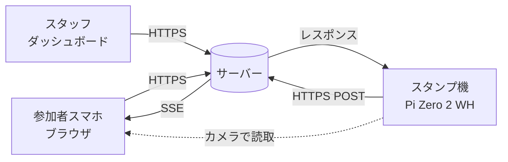
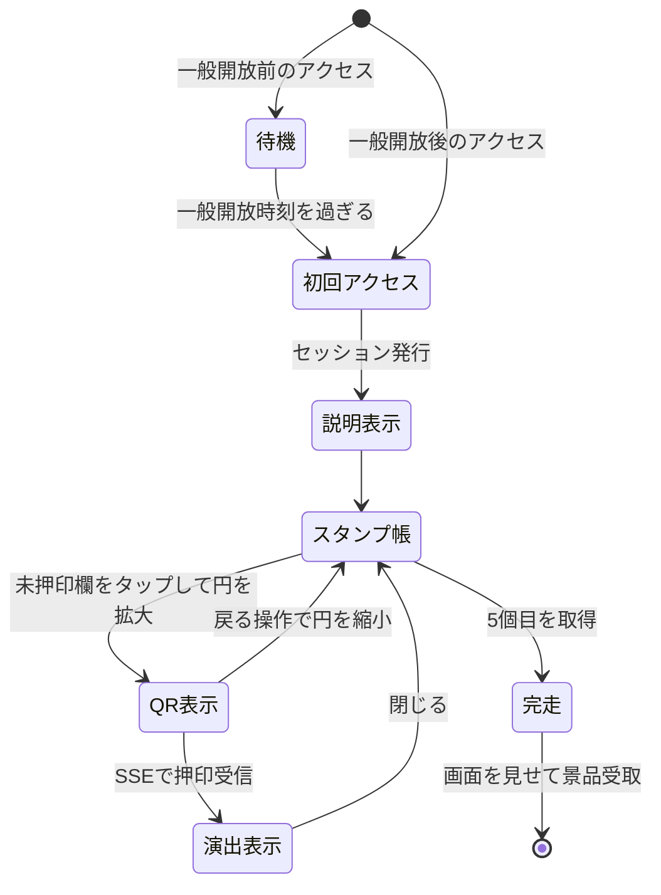
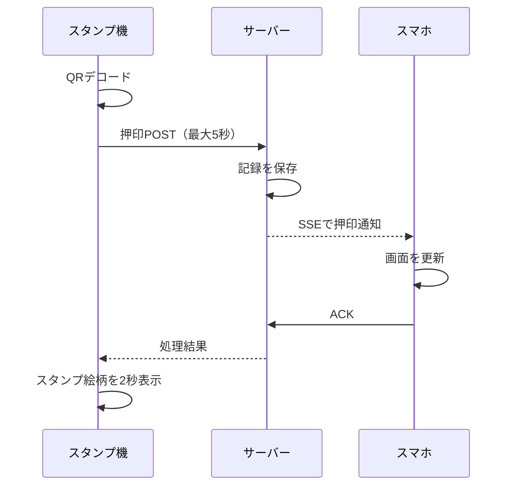

# 岡山大学ホームカミングデー デジタルスタンプラリー 仕様書 v1.10（正式版）

2026-09-20 · 作成 秋山 · 出典：企画書（2026-05-06・秋山）

## 1. 本書の位置づけ・スコープ

本書は企画書のうちソフトウェア3コンポーネント（参加者向けWebアプリ／サーバー／スタンプ機制御ソフト）を実装可能なレベルまで具体化したものです。筐体の3D設計、部品調達、当日の運営フローは対象外とします。バネとマイクロスイッチによる押し込み連動は実装しないため、機構設計はハードウェア側の判断に委ねます（6-5）。

**本書の状態**

設計は確定済みです。確認事項43件のうち、設計上の判断はすべて回答を得ています。表示コンテンツの確定データのみ未提供で、それまではサンプルデータを使います（4-6）。本文中の【Q-xx】は12章の決定記録への参照で、なぜその設計になったかを辿るためのものです。

出典は企画書（2026年5月6日）と、通信・レイテンシー試験の実装および実機試験結果です。試験実装で確認済みの内容は「確定」と明記しています。

**改訂履歴**：v1.0（9月20日）初版確定。v1.1（9月21日）レビュー指摘による記述の食い違いを解消し、送信結果の分類（6-7）を追加。v1.2（9月21日）技術スタック（2章）、Firestoreの保存方式（8章）、Cloud Runの費用の注意（12-2）を追加。v1.3（9月21日）データベースをFirestoreからSupabaseに変更。v1.4（9月21日）表示コンテンツとサンプルデータ（4-6）、spots テーブルの項目、/api/spots を追加。v1.5（9月21日）画面デザインの方向性（4-7）を追加し、QRの物理サイズの誤りを訂正。v1.6（9月21日）ヘッダーのタブ、協賛企業画面、説明のポップアップを追加（4-1、4-6）。v1.7（9月22日）スタンプ帳を1枚の台紙型へ変更し、押印欄を直接拡大するQR表示へ変更（4-1〜4-3、4-7）。10月31日16時以降のオフライン再送期限を同日中とし、11月1日に全キューを消去する運用を確定（5-2、6-7、Q-40）。v1.8（9月28日）実機試験の結果を反映。OSをデスクトップなしのLite版に限定し（6-1）、メインループが止まった場合の自動再起動を追加（6-8、10章、Q-41）。再起動を繰り返す機体を断として検知できるよう、初回ハートビートを起動30秒後に変更（5-6、Q-42）。スポットIDの決まり方の記述をサーバー側の対応付けに合わせて訂正（6-8）。v1.9（10月2日）本番環境での実機試験の結果を受け、QRの表示サイズを75×75から50×50 CSSピクセルへ縮小（4-1、4-2、6-2、Q-09）。v1.10（10月20日）一般開放前の待機画面を追加。10月31日10:00までは参加者向けWebアプリを待機画面だけにしてセッションを発行せず、管理画面で解除した端末だけ開放前に操作できるようにした（4-1、4-3、4-8、5-1、7章、9章、Q-43）。

**対象読者**：本企画のソフトウェア実装担当、ハードウェア担当、当日運営責任者。

## 2. システム全体構成

3つのコンポーネントがサーバーを中心に通信します。参加者のスマホとスタンプ機は直接通信しません（機械がスマホ画面のQRを光学的に読むだけ）。



スタンプ機からサーバーへの押印POSTが唯一の書き込み経路です。スマホ側はサーバーからSSEで結果を受け取るだけで、押印を自分で要求することはありません。

| コンポーネント | 実装 | 担当する責務 |
| --- | --- | --- |
| 参加者向けWebアプリ | TypeScript + React によるSPA | スタンプ帳表示、QR描画、SSE受信と定期ポーリング、演出、日英切り替え |
| サーバー | TypeScript（Node.js）+ Hono。Google Cloud Run（1インスタンス構成） | セッション発行、押印記録、SSE配信、機器監視、ダッシュボード提供 |
| スタンプ機制御ソフト | Python + OpenCV（Raspberry Pi Zero 2 WH・6台） | カメラ制御、QRデコード、押印POST、一時保存キュー、液晶表示、ハートビート送信 |
| スタッフ用ダッシュボード | サーバー同梱のWeb画面 | 機器死活監視、未送信キューの把握、参加状況 |

**技術スタック**

| 領域 | 採用 | 理由 |
| --- | --- | --- |
| サーバー | TypeScript（Node.js LTS）+ Hono | Webアプリと型を共有できる。数百本のSSE常時接続を無理なく捌ける |
| Webアプリ | TypeScript + React（Vite） | 確定済み（Q-20） |
| API型定義 | Zodスキーマを共有パッケージに置き、サーバーとWebの両方から参照 | APIの食い違いをコンパイル時に検出する |
| 配信 | Webアプリのビルド成果物をサーバーと同じCloud Runサービスから配信 | 同一オリジンになり、HttpOnly CookieとSSEがCORSなしで動く |
| データベース | Supabase（PostgreSQL、東京リージョン、無料プラン）。サーバーからのみ接続 | 利用経験がある。APIリクエストが無制限で、読み取り件数を気にせず設計できる。一意制約やSQLでの集計がそのまま使える |
| DBアクセス | Drizzle ORM。スキーマ定義とマイグレーションもこれで管理 | TypeScriptの型とテーブル定義を一致させられる |
| スタンプ機 | Python + OpenCV | 確定済み（6章） |
| リポジトリ | pnpm ワークスペースで server/・web/・shared/ を管理。device/ は独立したPythonプロジェクト |  |
| テスト | Vitest（サーバー・Web）、Playwright（E2E）、pytest（スタンプ機）、ローカルのPostgreSQL（Supabase CLI） |  |

言語はWebとサーバーのTypeScript、スタンプ機のPythonの2つです。サーバーをPythonにしても言語数は同じですが、型を共有できる境界が狭くなります。Web↔サーバー間のAPI（`/api/me`、SSE、ACK、管理画面）のほうが、スタンプ機↔サーバー間（押印とハートビートの2本）より広いため、そちらで型を揃えるほうが効果が大きいと判断しました。

## 3. 用語定義

以降、以下の語を固定して使います。コード上の識別子もこれに揃えます。

| 用語 | 定義 |
| --- | --- |
| セッション | 参加者1人分の単位。初回アクセス時に発行するIDで識別し、Cookieに保持する |
| セッションID | サーバーが発行するランダム文字列。参加者の実体を指す内部ID |
| 押印トークン | QRに埋め込む文字列。セッションIDとは独立に生成する推測不能な乱数で、イベント中は変わらない（5-2） |
| スポット | スタンプ機を設置する地点。全5か所。各機に1つ固定で割り当てる |
| スポットID | スポットの識別子。機体ではなく設置場所に紐づく |
| 機体ID | Pi Zero 1台ごとの識別子。故障交換時にスポットIDとの紐づけを付け替える |
| スタンプ枠（押印欄） | スタンプ台紙上の丸い1枠。未押印欄をタップすると同じ円が拡大してQRを表示し、押印後はスタンプ絵柄に変わる |
| 押印 | スタンプ機がQRを読み取りサーバーが記録を確定させた状態 |
| 完走 | 5スポット全てのスタンプを集めた状態 |
| ゴールページ | 5個目を取得した時点で自動遷移する完走画面。景品はこの画面を見せて受け取る |

## 4. 参加者向けWebアプリ仕様

アプリ不要・ログイン不要が最優先要件です。チラシのQRから開いた1つのURLだけで完結させ、インストール導線もアカウント作成導線も置きません。

### 4-1. 画面一覧

| 画面 | 到達方法 | 主な要素 |
| --- | --- | --- |
| 待機画面 | 一般開放（10月31日10:00）より前のアクセス（4-8） | イベント名、開始日時、当日にもう一度開くよう求める案内、日英切り替え。ヘッダーのタブは出さず、ほかの画面へは進めない |
| 初回説明画面 | 一般開放後、チラシQRから初回アクセス | 遊び方3ステップ、スタンプ機の写真、「スタンプはこのブラウザに保存されます」の注意、「はじめる」ボタン |
| 電子スタンプ帳画面 | ヘッダーのタブ。初回説明の後、以降はURL再訪で直接ここ | 1枚のスタンプ台紙。丸い押印欄5個を上段3・下段2で配置し、下部に景品引換券を置く。「遊び方」「景品交換所の案内」「スタンプが消えた方へ」の3つのボタンは台紙の外に置き、押すとポップアップで説明を表示 |
| QR表示状態 | スタンプ台紙の未押印欄をタップ | タップした丸い押印欄を画面中央へ拡大し、同じ円内に押印トークンのQRを50×50 CSSピクセルで表示する。説明文は表示せず、戻るアイコンだけを置く |
| 押印演出画面 | SSE受信時に、どのタブにいても自動でオーバーレイ表示 | 押されたスタンプの絵柄、獲得数、閉じるボタン |
| ゴールページ | 5個目の押印時に自動遷移。以降は台紙下部の景品引換券にある「ゴールへ」から | 完走メッセージ、景品交換所への案内。そのままスタッフに見せる画面 |
| スポット地図・一覧画面 | ヘッダーのタブ | Google Maps上に5スポットをピン表示。下部にリストを併設し、押印済みを区別して表示 |
| 協賛企業画面 | ヘッダーのタブ | 協賛企業のロゴ・名称・紹介文。リンクがあれば外部サイトを開く |

画面の切り替えは、ヘッダーに置くタブ（スタンプ帳・マップ・協賛企業）で行います。復旧画面は独立した画面にせず、「スタンプが消えた方へ」のポップアップとします。QR表示は独立画面として見せず、スタンプ台紙内の押印欄を拡大した表示状態として扱います。

### 4-2. 電子スタンプ帳とQR表示

QRは常に1つだけ画面に出します。スタンプ台紙の未押印欄をタップすると、その丸い押印欄が画面中央へ拡大し、同じ円内にQRが現れます。別のQR専用画面へ切り替わったようには見せません。カメラが隣の枠のQRを拾う問題は、拡大状態でほかの押印欄を画面外へ移すことで構造的に起きません。

- **枠の数**：5個。スポット5か所と1対1で対応します。ゴール専用の枠は設けません。
- **QR表示状態**：タップした押印欄の円を画面中央へ拡大し、その中央に押印トークンのQRを50×50 CSSピクセルで表示します。押印トークンは静的なので、枠ごとにQRの中身は変わりません。どの枠をタップしても同じQRが出ます。
- **押印済み枠の表示**：スタンプ絵柄に置換。絵柄の素材は秋山が9月中に準備します。同じ絵柄を機械の液晶でも押印時に表示するため、書き出しは2種類必要です（6-2）。
- **QRの物理サイズ**：50×50 CSSピクセルで確定（v1.8までの75×75から、実機試験で大きすぎたため縮小）。トークン22文字のQRは25×25マスのため、1マスがちょうど2 CSSピクセルになり境界がぼやけません。物理サイズに直すと、一般的なスマホでおよそ8mm角です（スマホのCSSピクセルは1つあたり約0.16mm）。小さめなので、QRのバージョンを上げないようトークンは短く保ちます（22文字程度、URLを含めずトークン単体、誤り訂正レベルはM）。読み取りが不安定なら最初に広げるのはこの値です。
- **画面輝度と自動ロック**：QR表示中はScreen Wake Lock APIで画面消灯を抑止します。輝度は端末設定に依存し、アプリから変更しません。QR表示中には輝度や押し当て方の案内文を表示しません。iOS SafariでのWake Lockの挙動は実機確認が必要です。
- **押印成功時**：QR表示状態を閉じ、押印演出へ遷移します。タップした枠ではなく、スタンプ機から通知されたスポットの枠を押印済みにします。
- **戻る操作**：画面上の戻るアイコン、ブラウザの戻る操作、Escキーで、QRを消しながら押印欄を台紙上の元の位置へ縮小します。
- **表示中の文言**：QR表示中は、見出し、注意書き、操作手順、スポット名、スポット番号を表示しません。

### 4-3. 状態遷移



### 4-4. 通信とリアルタイム反映

押印結果はサーバーからSSEで受信します。SSEは端末のスリープ・画面遷移・回線切替で切断されるため、以下を必須とします。

1. 切断検知後の自動再接続（指数バックオフ、上限5秒間隔）。
2. 再接続時は `/api/me` で全スタンプ状態を取得し直し、取りこぼしを補正。
3. 画面復帰（`visibilitychange`）時にも `/api/me` を再取得。
4. SSEの成否に関わらず、10秒間隔で `/api/me` を常時ポーリングする。失敗検知の分岐は設けず、原因を問わずあらゆる取りこぼしを最大10秒で回収する。

### 4-5. 対応環境

iOS Safari・Android Chromeの現行2バージョンを対象とします。それ以前および他ブラウザは動作対象外としつつ、致命的に崩れない程度のフォールバックを行います。

**多言語対応**：日本語と英語の2言語を実装します。ブラウザの言語設定で初期表示を切り替え、画面内で手動切り替えもできるようにします。対象はUI文言、スポット名、遊び方の説明です。日英の文言は、確定するまでサンプルを使います（4-6、Q-32）。

### 4-6. 表示コンテンツとサンプルデータ

以下の素材は現時点で確定情報が無いため、実装とテストはサンプルデータで進め、確定後に差し替えます。差し替えはデータファイルと画像の置き換えだけで済むようにし、コードの変更を要しない作りにします。

| 素材 | 必要な項目・形式 | 置き場所 | 現状 |
| --- | --- | --- | --- |
| スポット情報（5件） | スポットID（spot-01〜spot-05）、日本語名、英語名、表示順、緯度・経度、案内文（日英）、設置場所の補足（日英・任意） | server/ のシードデータ。spots テーブルへ投入する | サンプル |
| 画面の文言 | 遊び方3ステップ、完走メッセージ、景品交換所の名称・場所・案内文。いずれも日英 | web/ の翻訳ファイル | サンプル |
| スタンプ機の写真 | 初回説明画面に載せる写真1枚 | web/ の画像フォルダ | 仮画像 |
| スタンプ画像（Web用） | 5種。SVGまたは背景透過の高解像度PNG。ファイル名はスポットID | web/ の画像フォルダ | 確定（10月21日） |
| スタンプ画像（Pi用） | 5種。240×240のPNGまたはJPEG。ファイル名はスポットID | device/ の画像フォルダ | 確定（10月21日） |
| 協賛企業 | 企業名（日英）、ロゴ画像、紹介文（日英・任意）、リンクURL（任意）、表示順 | web/ のデータファイルとロゴ画像フォルダ | サンプル |

サンプルは一目でわかるようにします。スポット名と文言には「（サンプル）」を付け、仮画像にはスポットIDを描き込みます。座標はキャンパス内の仮の位置で構いません。

サンプルのまま本番を迎えないよう、シードデータと翻訳ファイルにサンプルかどうかのフラグを持たせます。サンプルのまま稼働している場合は、管理画面の上部に警告を表示します（7章）。

確定データの提供者と期限は未定です（Q-32）。

### 4-7. 画面デザイン

見た目は、昨年のポスターの配色（クリーム地、コーラル、焦げ茶、黄、紫）をネオブルータリズムで組み直した方向で確定です。スタンプ帳は「机に置かれた1枚のスタンプ台紙」として表し、丸い押印欄5つを上段3・下段2で配置します。台紙の下部には、完走後にゴールページを開く景品引換券を置きます。

押印欄同士を道、線、矢印で結ばず、台紙内の案内文で、順番の制約がないこと（Q-13）を伝えます。未押印欄をタップすると同じ円が拡大してQRを表示し、別画面へ切り替わった印象を与えません。

台紙のデザイントークン、コンポーネント、配置と、QR表示の拡大・縮小および表示要素は、正本 `docs/design.md` に定めます（Q-38）。設計差分は正本へ統合済みで、別の差分文書は参照しません。

### 4-8. 一般開放前の待機画面

チラシは事前に配るため、イベントより前にアプリを開く人がいます。一般開放（10月31日10:00、日本時間）より前は、参加者向けWebアプリを待機画面だけにし、操作できないようにします。開放時刻は稼働時間（11章、Q-01）の開始と同じです。10月30日以降はデプロイしない運用のため、手動の切り替えではなく、時刻による自動の開放とします。【Q-43】

- **判定**：サーバーの時計で判定し、スマホの時計は使いません。Webアプリは最初に `/api/status`（9章）を取得し、`open` が false なら待機画面だけを表示します。このとき `/api/me` の取得、SSE接続、10秒ポーリング（4-4）は始めません。開放前はセッションも発行しません（5-1）。
- **表示内容**：イベント名、開始日時、当日にもう一度開くよう求め、開いたままなら自動で始まることを伝える案内、日英の切り替えだけを置きます。遊び方、地図、協賛企業は載せません。開始日時は `opens_at` から日本時間で組み立て、文言に日時を直接書きません。見た目は `docs/design.md` 4-10 に従います。
- **自動開始**：`opens_at` と `server_time` の差だけ待ちます。1回の待ちは最大10分とし、そのたびに `/api/status` を取り直します。残りが10分以内になった最後の待ちにだけ、開放の瞬間にアクセスが集中しないよう0〜30秒のランダムな遅れを足します。画面復帰（`visibilitychange`）時にも取り直します。開放されていれば `/` を読み込み直し、ここでセッションを発行して初回説明画面へ進みます。
- **取得の失敗**：`/api/status` を取得できない場合は通信エラーを表示し、画面復帰時に再試行します。
- **スタッフの事前確認**：前日確認、当日朝の確認、開放前の実機試験のため、管理画面（7章）で解除した端末だけは開放前も通常どおり操作できます。開放前に発行したセッションは、すべてスタッフの試験用として扱えます。
- **スタンプ機**：押印とハートビートには開放前の制限をかけません。開放前の実機試験をそのまま行えるようにするためです。セッションが無ければ押印トークンも無いため、一般の参加者が開放前に押印することはありません。
- **開放時刻の設定**：サーバーの設定に定数で持ちます。ローカル開発と自動テストに限り、環境変数 `PARTICIPANT_OPEN_AT` で上書きできます。本番では設定しません。実際に効いている開放時刻は管理画面に表示します（7章）。

## 5. サーバー仕様

### 5-1. セッション発行

スタンプラリーURLへの初回アクセス時、Cookieが無ければサーバーがセッションIDを発行します。

- 一般開放（10月31日10:00）より前は、管理画面で解除した端末（7章）を除いて発行しません。Cookieの無いアクセスにもセッションを発行せずにWebアプリを返し、Webアプリが待機画面を表示します（4-8）。
- セッションIDは推測不能な乱数（128bit以上、URLセーフなBase64）とします。連番は不可です。
- Cookie属性は `HttpOnly` `Secure` `SameSite=Lax` とします。
- 有効期限は2026年11月30日までとします。`Max-Age` は発行時点からの相対秒数なので、当日発行なら30日相当です。データ保存期間と揃えています。
- 同一ブラウザからの再訪はCookieで同一セッションとして扱います。

### 5-2. QRに埋め込む値と不正対策

**静的トークン方式で確定です。** セッション発行時に押印トークンを1つ生成し、イベント中は更新しません。スマホ側でのトークン更新処理も、サーバーとの時刻同期も不要になります。

- トークンはセッションIDとは別の推測不能な乱数（128bit以上、URLセーフなBase64）とします。QRにセッションIDそのものは入れません。トークンからセッションIDへの逆引きはサーバー側テーブルで行います。
- 通常の押印はイベント終了時刻（10月31日16:00）までとします。16:00までに端末へ一時保存された押印は、端末側時刻を検証したうえで10月31日中に限り再送を受理します。11月1日0:00（日本時間）以降は受理しません。
- 静的である以上、QRのスクリーンショットを他人に送れば代理で押印できます。この不正は容認する方針で確定しており、対策は実装しません。

### 5-3. 押印処理

スタンプ機からのPOSTを受けて、サーバーが以下を順に実行します。試験実装で確認済みのACK往復を含みます。

1. 機体認証（5-5）を検証。失敗なら401。
2. 押印トークンの有効期限を検証。16:00以降の再送は `device_stamped_at` が16:00以前で、サーバー受信が10月31日中の場合だけ有効とする。期限切れなら記録せず404（invalid\_token）を返す。
3. トークンからセッションIDを解決。解決不能なら404（invalid\_token）。
4. 機体IDから現在のスポットIDを解決。
5. 同一セッション×同一スポットの既存記録を確認。あれば「既押印」として200で返し、新規記録は作らない。
6. 押印レコードを一意なイベントIDとともに作成（セッションID・スポットID・時刻・訪問順序）。
7. 該当セッションのSSEチャネルへ押印イベントを配信。
8. スマホからのACKを最大3秒待ち、受信を記録する。
9. スタンプ機へ結果を返却（枠番号・現在の獲得数・完走フラグを含む）。

**スタンプの成立条件**は、手順6のデータ保存完了時とします。ACKは画面到達の確認として扱い、ACKがタイムアウトしても保存済みの記録は取り消しません。通信切断による記録消失を避けるためです。ACK待機は3秒とし、タイムアウトした場合も端末へは成功として返します（6-4）。

押印順序に制約は設けません。どのスポットから回っても構わず、5個揃った時点で完走が成立します。

### 5-4. SSE配信

セッションIDごとにチャネルを持ち、押印イベントを配信します。

- イベント種別：`stamped`（押印成功）、`ping`（15秒ごとの生存確認）。
- 各 `stamped` イベントに一意なイベントIDを付与し、スマホはそのIDでACKを返します。同一イベントを複数回受信してもスタンプを重複表示・重複登録しません。
- `ping` はプロキシによるアイドル切断を防ぐために必須です。
- 同一セッションからの複数接続（タブを複数開いた場合）は全てに配信します。
- 想定同時接続数は目標参加者100名に対し安全側で300とします。

### 5-5. スタンプ機の認証

機体からのPOSTを無条件に受け付けると、誰でも押印を偽造できます。機体ごとに事前共有の APIキー を持たせ、`Authorization` ヘッダで送ります。キーは機体のローカル設定ファイルに置き、サーバー側テーブルで機体IDと突き合わせます。

### 5-6. ハートビート監視

機体から30秒ごとにハートビートを受信します。90秒（3回分）受信が途絶えた機体を「異常」とし、ダッシュボードにアラートを表示します。機体は起動直後には送らず、初回も起動から30秒後に送ります。30秒もたずに再起動を繰り返す機体（6-8）はハートビートが届かないため、起動のたびに送って「正常」に見えることがなく、断として検知されます。【Q-42】ハートビートには機体ID・稼働時間・直近の押印成功数・未送信キュー件数・電池残量（取得可能なら）を含めます。

## 6. スタンプ機制御ソフトウェア仕様

試験実装で実機確認済みの内容を確定仕様として引き継ぎます。基準実装は `qr_camera_lcs.py`、通信部は `stamp_latency_test/pi_stamp_client.py` です。

企画書の記載と異なる点が2つあります。**QRデコードはpyzbarではなくOpenCVの `QRCodeDetector`** であること、**バネ式スイッチとの連動は実装せず常時スキャン方式とする**ことです。後者は6-5にまとめました。

### 6-1. ハードウェア確定構成

| 部品 | 仕様 |
| --- | --- |
| Raspberry Pi | Zero 2 WH |
| カメラ | Raspberry Pi Camera Module（試験機ではIMX219として認識） |
| 円形ディスプレイ | GC9A01A 240×240 SPI 液晶。企画書ではOLEDと記載がありましたが液晶が正です |
| ネットワーク | インターネット接続が必要 |
| OS | Raspberry Pi OS Lite（64bit、Python 3.12以上を含むTrixie以降）。デスクトップ環境は使わない |

ディスプレイの結線は確定済みです。

| LCD信号 | Raspberry Pi側 |
| --- | --- |
| CS | CE0 / GPIO8 |
| DC | GPIO25 |
| RST | GPIO27 |
| SCLK | SPI0 SCLK / GPIO11 |
| MOSI | SPI0 MOSI / GPIO10 |

マイクロスイッチもLEDも使用しないため、追加のGPIO割り当ては不要です。使用するのは上記の液晶用ピンのみになります。

**OSはデスクトップなしで使います。** 実機試験で、デスクトップ版のOSでは電源投入直後にカメラ映像が止まる事象が毎回起きました。デスクトップのメディア管理（WirePlumber）がカメラを探索する処理と競合したためと考えられ、デスクトップを起動しない設定（`multi-user.target`）では起きませんでした。

### 6-2. カメラと表示（確定）

| 項目 | 仕様 |
| --- | --- |
| 入力解像度 | 640×480 |
| フレームレート | 15fps |
| QR解析間隔 | 3フレームに1回（毎秒5回） |
| 液晶表示 | 入力映像の中央を正方形に切り抜き240×240へ縮小 |
| 取り付け向き補正 | 映像を反時計回りに90度回転 |
| QR検出時 | 検出位置を緑色の枠で表示 |
| 読み取り成功時 | そのスポットのスタンプ絵柄を2秒間表示 |

**液晶はカメラ映像を映す方式で確定です。** 試験実装のまま映像を常時表示し、QRを検知したら緑色の枠を重ねて示します。読み取り成功時のみ、そのスポットのスタンプ絵柄へ2秒間切り替わります。試験実装の緑背景「QR READ」は絵柄表示に置き換えます。

**スタンプ絵柄は機械側と参加者のスタンプ帳の両方で使います。** 同じ原画から2種類の書き出しが必要です。

| 用途 | 形式 | 備考 |
| --- | --- | --- |
| Pi液晶 | 240×240のPNGまたはJPEG | 円形液晶のため四隅が切れます。円に収まる構図にしてください |
| Webアプリ | SVGまたは高解像度PNG（背景透過） | スタンプ帳の枠に重ねるため背景透過が必要です |

5スポット分の画像を全機体に入れ、設定されたスポットIDで選択します。こうしておくと予備機へ差し替えるときに画像を入れ替える必要がありません。起動時に全画像をメモリへ読み込み、押印時のファイル読み込み待ちが起きないようにします。確定画像が届くまでは、スポットIDを描き込んだ仮画像を使います（4-6）。

内蔵LEDも使用しないため、読み取り時の光源はスマホ画面そのものだけになります。筐体の遮光と画面輝度が読み取り成功率を直接左右します。4-2のWake Lockは維持しますが、QR表示中の輝度案内は置かないため、実機試験では通常の端末輝度でも50×50 CSSピクセルのQRを安定して読めることを確認します。

### 6-3. QR認識と送信（確定）

- デコードはOpenCVの `QRCodeDetector` を使用します。
- 復号した文字列をそのまま押印トークンとしてサーバーへ送ります。
- サーバー通信はカメラ表示とは別のワーカースレッドで実行します。
- 同時に処理する押印送信は1件までです。送信中に別のQRを認識しても、その送信は行いません。
- 同一QRの再送は3秒後から可能です。
- HTTPリクエストのタイムアウトは5秒です（試験実装は10秒）。サーバー側の最長処理はACK待機3秒と保存処理で約3.5秒のため5秒で足り、通信不能時に参加者が押し当てたまま待つ時間を半分にできます。
- 通信成功時はACKと各区間のレイテンシーを端末ログへ出力します。
- 送信結果の扱いは6-7の分類に従います。試験実装は通信失敗時にエラーログを出して継続するのみでした。

端末側の3秒クールダウンは連打防止であって、重複取得ルールではありません。同一セッション×同一スポットの重複判定はサーバー側で行います（5-3）。

### 6-4. 押印シーケンス

端末のHTTPレスポンスは、サーバーがスマホからACKを受け取るまで待ちます。ACK待機は3秒とし、試験実装の5秒から短縮します。試験ではQR認識完了からスマホACKまで333〜467msだったため、3秒あれば十分な余裕があります。



ACKがタイムアウトしても、保存済みの記録は取り消しません。端末には成功としてスタンプ絵柄を表示します。記録は既に成立しており、ここで失敗と出すと押し直しを誘発して混乱するためです。タイムアウトの事実はログとダッシュボードにのみ残します。

### 6-5. 常時スキャン方式（確定）

**スイッチ連動は実装しません。** 試験実装のまま、QRが視野に入れば自動で読み取る常時スキャン方式で本番へ進めます。GPIO入力の実装、デバウンス処理、スイッチ配線はいずれも不要です。

この決定に伴う留意点が3つあります。

1. 押し込み動作は遮光と体験演出のための機構として残り、読み取りの引き金にはなりません。バネとマイクロスイッチを筐体に組み込むかどうかはハード側の判断になります。
2. 筐体に近づけただけで読み取られるため、意図しない押印を防ぐのは端末の3秒クールダウンとサーバー側の重複判定だけになります。同一スポットでの重複はサーバーが弾くので実害は限定的です。
3. 押し当て前に読み取られると、参加者が「押した」と認識する前にスタンプが付きます。液晶の表示（成功時のスタンプ絵柄ほか、6-7）が唯一の合図になります。

### 6-6. カメラ起動遅延（解決済み）

企画書でリスクとして挙がっていた項目ですが、試験実装は既にカメラを常時起動したまま毎フレーム処理する構成です。押印のたびにカメラを初期化する必要はなく、起動遅延は発生しません。

残る確認事項は、常時起動に伴う発熱と消費電力をバッテリー容量と筐体の放熱で吸収できるかです（【Q-14】）。

### 6-7. 送信結果の分類と表示（確定）

サーバーへの送信結果を5つに分類し、液晶の表示とローカルキューの扱いを決めます。「成功」と「通信エラー」の二択にはせず、**サーバー保存前であることを明示する「一時保存」を第三の状態**として設けます。保存前に成功と同じ表示を出すと、スマホに反映されない間に参加者が混乱します。逆にエラーと出すと押し直しを誘発します。

| 結果 | 判定条件 | 液晶表示 | キュー |
| --- | --- | --- | --- |
| 押印成功 | 200 `stamped` | スタンプ絵柄を2秒 | 積まない |
| 取得済み | 200 `already` | スタンプ絵柄にチェックを重ねて2秒 | 積まない |
| 一時保存 | 接続不能、タイムアウト、5xx、408、429 | 黄色系の背景に時計アイコンと「あとで反映されます」を3秒 | 積んで再送 |
| 無効なQR | 404 `invalid_token`、その他の4xx | ×アイコンと「このQRは使えません」を2秒 | 積まない |
| 端末の認証エラー | 401、403 | 工具アイコンと「スタッフを呼んでください」を5秒 | 積まない |

ACKのタイムアウトはサーバー側で保存済みのため200が返り、「押印成功」に分類されます（6-4）。

4xxのうち408と429は一時的な失敗なので再送対象に含めます。認証エラーは参加者には解決できない端末側の問題のため、無効なQRとは表示を分けます。ハートビートも同じAPIキーで失敗するので、ダッシュボードにも断として現れます。

**液晶の文言。** 240×240の円形液晶に収まるよう、アイコン主体で短文を添えます。日英の2行表記とし、日本語を描画するため日本語フォント（Noto Sans CJKなど）を機体に同梱します。試験実装はASCIIの「QR READ」のみを描画していたため、フォントの追加が必要です。

**キューの扱い。**

- キューのレコードには端末側のタイムスタンプを持たせ、サーバー側でそれを押印時刻として採用します。
- Pi ZeroにはRTCが無く再起動で時刻がずれるため、起動時のNTP同期を前提とします。
- 同じトークンのレコードは1件にまとめ、キューに重複を積みません。
- 通信回復後、古い順に5秒間隔で再送します。
- 10月31日16:00以降も同日中は再送を続けます。ただし、16:00までに読み取って一時保存したレコードだけを対象とします。
- 11月1日0:00（日本時間）になった時点で、送信成否を問わず全キューを削除し、それ以降は再送しません。停止中だった端末も、次回起動時に全キューを削除します。
- 再送の結果が `stamped` または `already` ならキューから削除します。再送対象外の4xxが返ったら破棄してログに残します。それ以外はキューに残して再送を続けます。
- キューはファイルへ永続化し、プロセス再起動でも失いません。
- 未送信件数をハートビートに含め、ダッシュボードで確認できるようにします（5-6、7章）。

一時保存となった押印は、再送でサーバーに記録された時点でスマホへSSEまたは10秒ごとのポーリングで反映されます（4-4）。

### 6-8. 終了処理と常駐化

終了処理は確定済みです。

- `Ctrl+C` で安全に終了できます。
- カメラを停止してリソースを解放します。
- 液晶を黒画面にします。
- 実行中の送信処理を終えてからプロセスを停止します。

本番ではこれに加え、systemdでの常駐起動と異常終了時の自動再起動を設定します。電源投入からサービス開始まで60秒以内を目標とします。

**プロセスが終了せずに止まった場合も自動再起動の対象とします。** カメラからフレームが届かなくなると、カメラ映像の取得を待ったままメインループが止まり、液晶の映像とハートビートが同時に途絶えます。プロセスは生きているため、systemdは異常に気付きません。そこで、メインループが5秒以上進まない場合は、実行中の送信処理（最大1件）を終えてから異常終了し、systemdに5秒後に再起動させます。送信に失敗した押印はキューへ積まれるため、この終了で押印は失われません（6-7）。【Q-41】

**機体のローカル設定ファイル**には、機体ID、APIキー、液晶に表示するスタンプ絵柄のスポットIDを書きます。押印を記録するスポットは、サーバーが機体IDから解決します（5-3）。ローカル設定のスポットIDは絵柄の選択（6-2）にだけ使い、サーバーへは送りません。両者が食い違うと、液晶の絵柄と記録されるスポットがずれるため、設置時にサーバー側の対応と一致させます。

## 7. スタッフ用ダッシュボード仕様

当日の運営で必要な最小限に絞ります。スマホからも見られるレイアウトとします。

| 画面 | 内容 |
| --- | --- |
| 機器稼働状況 | 機体ごとの最終ハートビート時刻、状態（正常／警告／断）、直近の押印数、未送信キュー件数、当日のACK未到達件数と最終発生時刻。異常機体とキューが溜まっている機体は画面上部に固定表示 |
| 参加状況 | 累計参加者数、スポット別押印数、完走者数。目標値（参加100名・完走60%）との対比 |
| 参加者画面の公開 | 一般開放の日時と現在の状態（開始前／公開中）。開始前は「この端末で開始前の参加者画面を使う」ボタンを置き、押した端末だけ待機画面を通れるようにする（4-8） |

景品交換は参加者がゴールページをスタッフに見せるだけとしたため、ダッシュボード側の照合機能と交換済みフラグは実装しません。同じ画面を複数人で見せ回る、あるいはCookieを消して再参加するといった重複受け取りは、スタッフの目視に委ねることになります。

ダッシュボードへのアクセス制限は共有パスワード1つで確定です。当日スタッフ間で共有し、イベント終了後に変更します。個別アカウントは作りません。

**開始前の解除。** 「この端末で開始前の参加者画面を使う」を押すと、サーバーがその端末に解除用のCookieを渡します。Cookie属性は `HttpOnly` `Secure` `SameSite=Lax`、期限は10月31日16:00です。値は共有パスワードを鍵にしたHMACとし、サーバーには何も保存しません。そのためサーバーが再起動しても解除は有効なままです。共有パスワードを変えると、それまでの解除は無効になるので、変更後に解除し直します。

**一人運用の前提。** 当日の運用は秋山が単独で担当します。5スポットを一人で見るため、ダッシュボードを常時注視できない前提でアラートを設計します。機器の断検知は画面上部の固定表示に加え、音またはブラウザ通知で知らせる形とし、スマホで開いたまま持ち歩ける画面にします。画面は30秒ごとに自動更新します。サンプルデータのまま稼働している場合は、画面上部に警告を表示します（4-6）。

## 8. データモデル

企画書の収集データ「セッションID・スポットID・訪問時刻・訪問順序」を満たしつつ、機器監視と配信確認に必要な分を加えています。押印トークンは stamp\_tokens に一元管理し、sessions には持たせません。

**保存先とアクセス方式。** 永続データはSupabaseのPostgreSQLに保存し、以下の表をそのままテーブルとします。接続するのはサーバーだけで、ブラウザからは直接触らせません。Supabaseの認証機能、Realtime、ストレージは使わず、純粋なPostgreSQLとして扱います。

読み取りも書き込みもDBへ直接行います。Supabaseの無料プランはAPIリクエストが無制限なので、10秒ポーリングもそのまま処理できます。100名が同時に開いていても毎秒10件程度の単純な読み取りです。機体のハートビート状態（最終受信時刻、状態、未送信キュー件数）は監視用の一時情報なので、DBには保存せずメモリだけで持ちます。

**接続と運用の注意。**

- Cloud Runからは、Supabaseの接続プーラー（Supavisor）のSession modeの接続文字列を使います。無料プランの直接接続はIPv6専用で、IPv4で繋ぐにはプーラーを経由する必要があるためです。
- 全テーブルでRLSを有効にし、ポリシーは置きません。SupabaseのデータAPI経由のアクセスをすべて拒否するためです。サーバーはテーブルの所有者として接続するので、RLSの影響を受けません。
- 接続文字列はCloud Runの環境変数として渡し、リポジトリには含めません。
- 無料プランは1週間アクセスが無いとプロジェクトが一時停止されます。開発完了からイベントまで約1か月空くため、Cloud Schedulerなどから3日おきに `/api/health` を呼び、DBへの問い合わせを発生させます。加えて10月30日にダッシュボードで稼働を確認します。
- 無料プランには自動バックアップがありません。イベント終了後、保存期間内に必要なデータをCSVで書き出します。

**sessions**（参加者）

| カラム | 型 | 説明 |
| --- | --- | --- |
| id | string | セッションID（主キー） |
| created\_at | timestamp | 初回アクセス時刻 |
| user\_agent | string | 端末傾向の分析用 |

**stamp\_tokens**（押印トークン）

| カラム | 型 | 説明 |
| --- | --- | --- |
| token | string | QRに埋め込む値（主キー） |
| session\_id | string | 紐づくセッション |
| issued\_at | timestamp | 発行時刻 |

**spots**（スポット）

| カラム | 型 | 説明 |
| --- | --- | --- |
| id | string | スポットID（主キー）。spot-01〜spot-05 |
| name\_ja | string | 日本語名 |
| name\_en | string | 英語名 |
| display\_order | int | スタンプ帳上の枠順 |
| lat | double | 緯度 |
| lng | double | 経度 |
| description\_ja | string | 案内文（日本語） |
| description\_en | string | 案内文（英語） |
| location\_note\_ja | string | 設置場所の補足（日本語・任意） |
| location\_note\_en | string | 設置場所の補足（英語・任意） |

spots の初期データはシードファイルから投入します。確定情報が届くまではサンプルデータを使います（4-6）。

**stamps**（押印記録）

| カラム | 型 | 説明 |
| --- | --- | --- |
| id | int | 連番 |
| session\_id | string | 押した参加者 |
| spot\_id | string | 押されたスポット |
| stamped\_at | timestamp | サーバー記録時刻 |
| device\_stamped\_at | timestamp | 機体側の時刻（オフライン復旧時に使用） |
| device\_id | string | 押印した機体 |
| visit\_order | int | そのセッション内での訪問順序 |

session\_id と spot\_id の組に一意制約を張り、`INSERT ... ON CONFLICT DO NOTHING` で書き込みます。行が挿入されなければ既存の記録があるので、`already` として扱います。端末からの再送もこの仕組みで冪等になります。

**deliveries**（配信とACK）

| カラム | 型 | 説明 |
| --- | --- | --- |
| event\_id | string | 押印イベントの一意ID（主キー） |
| stamp\_id | int | 対象の押印記録 |
| session\_id | string | 配信先セッション |
| delivered\_at | timestamp | SSE配信時刻 |
| acked\_at | timestamp | ACK受信時刻。未受信はnull |
| result | string | 配信結果 |

**devices**（機体）

| カラム | 型 | 説明 |
| --- | --- | --- |
| id | string | 機体ID（主キー） |
| api\_key\_hash | string | 認証キーのハッシュ |
| spot\_id | string | 現在の設置スポット。交換時に更新 |
| last\_heartbeat\_at | timestamp | 最終ハートビート受信時刻 |
| status | string | 正常／警告／断 |

## 9. API仕様

全エンドポイントHTTPS。参加者向けはCookie認証、機体向けはAPIキー認証です。試験実装のパスとデータ形式は本番APIとして確定していません。特に、URL上の `client_id` とリクエスト本文の生の利用者IDは廃止し、認証済みセッションまたは期限付きトークンへ置き換えます。

| メソッド | パス | 呼び出し元 | 用途 | 試験実装での相当 |
| --- | --- | --- | --- | --- |
| GET | `/` | 参加者 | 初回アクセス。Cookie未保持ならセッション発行してリダイレクト。一般開放前は発行せずにWebアプリを返す（4-8） | `GET /` |
| GET | `/api/status` | 参加者 | 一般開放の状態と開放時刻を取得（4-8） | なし（新規） |
| GET | `/api/me` | 参加者 | 押印トークン・押印状態・完走判定を取得 | `GET /qr/{client_id}` を置換 |
| GET | `/api/spots` | 参加者 | 5スポットの名称・座標・案内文（日英）を取得 | なし（新規） |
| GET | `/api/events` | 参加者 | SSE接続。`stamped` と `ping` を配信 | `GET /events/{client_id}` |
| POST | `/api/stamp` | 機体 | 押印記録。本システムの中核 | `POST /stamp` |
| POST | `/api/ack` | 参加者 | 押印イベントの受信確認 | `POST /ack` |
| POST | `/api/heartbeat` | 機体 | 30秒ごとの死活通知 | なし（新規） |
| GET | `/api/health` | 監視 | 接続状態確認。DBへの疎通確認を含み、Supabaseの一時停止防止にも使う | `GET /health` |
| GET | `/api/admin/devices` | スタッフ | 機体一覧と稼働状況 | なし（新規） |
| GET | `/api/admin/stats` | スタッフ | 参加者数・スポット別押印数・完走数 | なし（新規） |
| POST | `/api/admin/preview` | スタッフ | この端末に開始前の解除Cookieを渡す（7章） | なし（新規） |

QR画像はサーバーで生成せず、`/api/me` が返したトークンからReact側で描画します。押印トークンが静的なため画像生成用のエンドポイントは不要です。景品交換を画面提示のみとしたため、交換記録用のエンドポイントも設けません。

**POST /api/stamp**

リクエスト：

```json
{
  "token": "QRから読み取った押印トークン",
  "device_id": "dev-01",
  "device_stamped_at": "2026-10-31T13:24:05+09:00"
}
```

レスポンス（成功）：

```json
{
  "result": "stamped",
  "spot_id": "spot-03",
  "spot_name": "工学部前",
  "stamp_count": 3,
  "total_spots": 5,
  "completed": false
}
```

`result` は `stamped`（新規押印・200）、`already`（既押印・200）、`invalid_token`（トークン不正・404）のいずれかです。機体認証に失敗した場合は401を返します。16:00以降の再送は `device_stamped_at` が16:00以前、かつサーバー受信が10月31日中の場合だけ受理します。端末側の表示とキューの扱いは6-7の表のとおりです。

**GET /api/me**

```json
{
  "token": "押印トークン",
  "token_expires_at": "2026-10-31T16:00:00+09:00",
  "stamps": [
    { "spot_id": "spot-01", "stamped_at": "2026-10-31T12:10:33+09:00" }
  ],
  "completed": false
}
```

セッションIDはHttpOnly Cookieで保護しているため、レスポンスには含めません。

**GET /api/status**

```json
{
  "open": false,
  "opens_at": "2026-10-31T10:00:00+09:00",
  "server_time": "2026-10-30T18:00:00+09:00"
}
```

`open` は、一般開放時刻を過ぎているか、管理画面で解除した端末（7章）なら true です。セッションの有無に関わらず呼び出せ、DBにはアクセスしません。キャッシュさせないよう `Cache-Control: no-store` を付けます。待機画面はこの値で待ち時間を決めます（4-8）。

**POST /api/admin/preview**

共有パスワードで認証し、この端末に開始前の解除Cookieを渡します（7章）。本文は不要で、成功時は `{ "ok": true }` を返します。認証に失敗した場合は401です。

**POST /api/ack**

SSEで受け取った押印イベントの到達確認です。イベントIDとセッションの対応をサーバー側で検証してから受理します。

```json
{
  "event_id": "evt_01HXY..."
}
```

## 10. 異常系の扱い

当日その場で参加者が困る状況を優先して定義します。

| 事象 | 参加者から見える挙動 | システムの処理 |
| --- | --- | --- |
| QRが読み取れない | 液晶に緑枠が出ない。スマホ側は変化なし | 記録なし。押し当て直してもらう |
| 同じスポットで再度押した | 液晶にスタンプ絵柄とチェックを表示 | 200で `already` を返し新規記録なし |
| 無効なQRを読んだ | 液晶に「このQRは使えません」 | 404。キューに積まない |
| 機体からサーバーへ到達しない | 液晶に「あとで反映されます」。スマホは通信回復後に反映 | キューへ一時保存し、通信回復後に再送（6-7） |
| SSEが切れている | 押印してもスマホ画面がすぐには変わらない | 再接続時と10秒ごとのポーリングで `/api/me` を再取得し追いつく |
| スマホのCookieが消えた | スタンプが全て消えた状態で表示 | 復旧処理なし。「スタンプが消えた方へ」のポップアップで説明し、秋山が当日判断（12-3） |
| 機体が90秒以上無応答 | 該当スポットで押印不可 | ダッシュボードに音・通知つきアラート。予備機と交換 |
| 機体のカメラが止まった | 液晶の映像が止まり、15秒ほど読み取れない | メインループの停止を5秒で検知して異常終了し、systemdが自動再起動する。30秒もたずに再起動を繰り返す場合は、ハートビートが届かずダッシュボードで断になるので予備機と交換（5-6、6-8） |
| サーバーが停止 | 各機体の液晶に「あとで反映されます」。スマホには反映されない | 各機体がキューへ一時保存し、10月31日中は復旧後に再送。11月1日になったら全キューを削除。秋山が復旧対応 |

## 11. 非機能要件

**性能**

試験環境での実測は以下のとおりです。測定10回でACK失敗・タイムアウトは0回でした。これは参考値であり、本番の保証値ではありません。

| 区間 | 実測 |
| --- | --- |
| サーバーからスマホACKまで | 平均64.9ms |
| QR認識完了からスマホACKまで | 333〜467ms |

本番の目標値は以下とします。

- QRがカメラの視野に入ってから液晶にスタンプ絵柄が出るまで2秒以内。押し当てた感覚と表示がずれると体験が崩れます。解析は毎秒5回なので検出まで最大約0.2秒、実測の往復約0.5秒と合わせても十分な余裕があります。
- 押印POSTのサーバー処理（保存まで）は 300ms以内。
- SSE配信は押印記録から 1秒以内 にスマホへ到達すること。

想定規模は参加者100名、同時SSE接続は最大300（5-4）、稼働端末5台と予備1台です。

**可用性**

- 稼働時間は10月31日の10:00〜16:00の6時間です。この間は無停止を前提とします。
- 実行基盤はGoogle Cloud Runで確定です。当日は `--timeout 3600`、`--min-instances 1 --max-instances 1 --concurrency 1000`、CPU常時割り当てで構成します。この設定は費用がかかるため、期間を限定します（12-2）。
- 押印記録はSupabaseへ永続化し、デプロイやインスタンス再起動で失いません（8章）。
- SSE接続とACK待ちの情報はメモリ管理とします。単一インスタンス構成のため、複数インスタンス間のファンアウトは実装しません。
- SSE接続はCloud Runのタイムアウトにより最長60分で切れますが、EventSourceが自動再接続するため実害はありません。
- イベント中はデプロイしません。デプロイ時は新旧のインスタンスが一時的に並走し、メモリ上の状態が分かれるためです。
- max-instancesが1である以上サーバーは単一障害点です。障害時は各機体がキューへ一時保存し、復旧後に再送します（6-7）。

**セキュリティ**

- 全通信HTTPS。
- 機体はAPIキーで認証。キーは機体ごとに別の値とします。
- 押印トークンは推測不能な乱数から生成します。

**プライバシー**

- 収集するのはセッションID・押印記録・User-Agentのみです。氏名・学籍番号・位置情報は収集しません。景品交換も画面提示のみのため、本人確認情報は発生しません。
- 個人情報の取り扱い説明は掲示しません。個人を特定できる情報を扱わないためです。
- データの保存期間は1か月とします。11月30日を目安に削除し、翌年度への引き継ぎは考慮しません。

## 12. 決定事項の記録

挙げた40件について、設計上の判断はすべて確定しました。ただし表示コンテンツ（スポット情報、日英の文言、写真、スタンプ画像、協賛企業）の確定データはまだ無く、サンプルデータで実装を進めています（4-6、Q-32）。以下は判断の経緯を残すための記録です。

### 12-1. 基本設計に関する決定

| ID | 確認事項 | 回答・現状 |
| --- | --- | --- |
| Q-01 | 本番日と稼働時間帯はいつですか | 10月31日 10:00〜16:00 |
| Q-02 | 押印トークンは静的（A案）と短命（B案）のどちらにしますか | 静的トークンで確定。更新処理も時刻同期も不要（5-2） |
| Q-03 | 未押印枠が複数あるとき、QRは全枠に表示しますか、それとも1枠だけですか | スタンプ台紙の未押印欄をタップすると、その円だけを拡大してQRを1つ表示。同時に複数のQRは出ないため、隣の枠を拾う問題は起きません（4-2） |
| Q-04 | スポットは何箇所で、ゴール押印はそのうちの1つですか、別枠ですか | スポット5か所。5個揃った時点で完走成立。ゴール専用枠は設けない（Q-31） |
| Q-05 | 完走の条件は全スポット制覇ですか、規定数（例：5個中3個）ですか | 5スポット全制覇 |
| Q-07 | 景品交換時、参加者は画面を見せるだけですか。スタッフが端末を操作しますか。本人確認をしますか | 完走画面をスタッフに見せるだけ。照合機能と交換済みフラグは作りません（7章） |
| Q-16 | 通信失敗時、ローカルキューに積んで成功として返しますか、失敗としてやり直しを求めますか | ローカルキュー方式。ただし成功とは表示を分け、「一時保存」を第三の状態とする（6-7、Q-34） |
| Q-19 | サーバーのホスティング先と予算はどうしますか | Cloud Runで確定。設定の要点は12-2 |
| Q-20 | フロントエンドの技術選定に指定はありますか | TypeScript + React |
| Q-26 | ソフトウェア開発は企画書上7月予定でしたが、現在9月20日です。本番までの残り期間と開発人員は確保できていますか | 9月中に完了 |
| Q-29 | スイッチ連動を作り込みますか、常時スキャンのまま進めますか | 実装しません。常時スキャン方式で確定（6-5） |
| Q-30 | ACKがタイムアウトしたとき、端末にはどう表示しますか | 成功としてスタンプ絵柄を表示。ACK待機は5秒から3秒へ短縮（6-4） |
| Q-31 | ゴール専用のスタンプ枠を設けるか | 設けません。枠は5個で、5個目の取得と同時にゴールページへ遷移します |

### 12-2. Q-19 Cloud Runについて

Cloud RunでSSEは問題なく動きます。試験実装も既にCloud Run上で平均64.9msを出しています。設定すべき点は3つです。

1. **リクエストタイムアウトを延ばす。** 既定値のままでは長時間のSSE接続が切られます。最大60分まで設定できるので `--timeout 3600` とします。6時間のイベント中に接続が1時間ごとに切れますが、EventSourceが自動再接続するため実害はありません。
2. **インスタンス数を1に固定する。** SSE接続とACK待ちをメモリで管理する構成では、押印POSTと該当セッションのSSE接続が別インスタンスに分かれると通知が届きません。`--min-instances 1 --max-instances 1 --concurrency 1000` とすれば、100名規模は1インスタンスで十分足ります。min-instancesを1にしておけばコールドスタートも避けられます。
3. **CPUを常時割り当てにする。** ハートビートの断検知など、リクエスト外で動く処理を止めないためです。

max-instancesを1にすると単一障害点になりますが、この規模ではRedisやPub/Subでファンアウトを組むほうが当日の不確実性を増やします。9月中の完了を優先するなら1インスタンス構成を推奨します。

**費用の注意。** min-instancesを1にしてCPUを常時割り当てにすると、アクセスが無くても課金が続きます。1 vCPUを1か月つけっぱなしにすると月60ドル前後になります。常時割り当ての無料枠は月24万vCPU秒で、1 vCPUなら約2.7日分です。そこでこの設定はリハーサル日と、イベント前日から当日終了までに限ります。それ以外の期間は min-instances を0、CPUはリクエスト処理中のみの割り当てに戻します。こうすれば無料枠に収まります。

### 12-3. Q-08 Cookieが消える可能性について

6時間のイベント中にブラウザがCookieを実際に削除する確率は低いです。懸念すべきは削除そのものではなく、**別のブラウザで開き直されること**です。症状は同じ「スタンプが消えた」になります。

| 経路 | 起きやすさ | 説明 |
| --- | --- | --- |
| アプリ内ブラウザと標準ブラウザの行き来 | 中 | 最も現実的です。チラシのQRから開けば標準ブラウザですが、URLがLINEやSNS経由で回るとアプリ内ブラウザは別のCookie保管庫を使うため、同じURLでも新規参加者として扱われます |
| プライベートブラウズでの利用 | 低 | タブを閉じた時点で消えます。一定数はいますが多数ではありません |
| 途中での端末の乗り換え | 低 | 6時間のイベント中に別端末へ移る人はほぼいません |
| 利用者による履歴・サイトデータの削除 | 極低 | イベント中に行う理由がありません |
| ストレージ逼迫による破棄 | 極低 | 6時間前に発行したCookieが対象になることは実質ありません |

Safariの7日上限はJavaScript由来のストレージに対する制限で、サーバーが `Set-Cookie` で発行するHttpOnly Cookieには適用されません。いずれにせよ6時間なので無関係です。

100名規模なら、影響を受けるのは数名程度と見ています。

ここで前提として押さえておきたいのは、**アプリ側では「消えた人」と「初参加の人」を区別できない**ことです。どちらもCookieが無い初回アクセスとして届き、サーバーにも両者を結ぶ手がかりがありません。そのため「スタンプが消えました」という画面を検知して出すことはできず、初参加の人全員に同じ文言を見せてしまいます。案内の出し方は次の2通りになります。

- **起きる前に伝える。** 初回説明画面に「スタンプはこのブラウザに保存されます。別のアプリやブラウザで開くと最初からになります」と明記する。
- **本人が辿れるようにする。** スタンプ帳に「スタンプが消えた方へ」ボタンを常設し、押すとポップアップで説明とスタッフへの案内を表示する。本人が押すため検知は不要。

この2つはコピーと静的画面だけで済み、復旧処理を作らなくても成立します。そのうえで対策は3案あります。

| 案 | 実装量 | 効果 |
| --- | --- | --- |
| 何もしない | ゼロ | 復旧処理は作らず、上記2つの案内のみ用意します。該当者はスタッフ判断で対応し、5スポットを残り時間で回り直してもらいます |
| 復旧用URLを案内 | 小（数時間） | 識別は従来どおりCookieのセッションIDで行い、URLのトークンはCookieが無いときだけ読む予備の入口として扱います。別ブラウザで開き直された場合にも効くのはこの案だけです |
| 復旧コードの発行 | 中 | 6〜8桁のコードを表示し、再入力で復帰。事前に控える人が少なく効果は限定的です |

**決定：何もしない（案内のみ）です。** 復旧用URLと復旧コードはいずれも実装しません。用意するのは上記2つの案内、つまり初回説明画面での事前説明と、スタンプ帳の「スタンプが消えた方へ」ボタンだけです。該当者が出た場合は当日その場で秋山が判断します。

### 12-4. Q-10 SSEとポーリングについて

SSEは、ブラウザがサーバーへHTTP接続を1本張りっぱなしにして、サーバー側から一方的にイベントを流す仕組みです。ブラウザは `EventSource` で受けます。押印はスマホの外（機械→サーバー）で起きるため、スマホ側から取りに行かない限り気づけません。SSEはその通知路です。

実務上、SSEが届かなくなるのは次の3つです。

| 経路 | 起きやすさ | 補足 |
| --- | --- | --- |
| 画面がバックグラウンドへ回る、端末がロックされる | 中 | JSが止まり接続が切れます。復帰時にEventSourceが自動再接続しますが、その間のイベントは取りこぼします。今回はQR表示中が前面なので、押印の瞬間に当たる確率は低めです |
| 経路上のプロキシによるバッファリング | 低 | HTTPSのため中間でのバッファリングは起きにくく、15秒ごとのpingでも緩和されます |
| Cloud Runのリクエストタイムアウト | 確実だが無害 | 最長60分で切れますが自動再接続します |

再接続時と `visibilitychange` での `/api/me` 再取得は、どの案を採っても必須です（4-4）。これがあれば「画面に戻ったら反映されている」までは担保できます。問題は、開いたまま待っている最中に取りこぼした場合です。

| 案 | 実装量 | 効果 |
| --- | --- | --- |
| 追加しない | ゼロ | SSEが張れない端末では押印しても画面が変わりません。機械側は絵柄を出すので、「機械は反応したのにスマホが変わらない」状態になります |
| 低頻度の常時ポーリングを併用 | 小（数時間） | SSEの成否に関わらず10秒ごとに `/api/me` を叩きます。失敗検知の分岐が不要で実装が単純、あらゆる取りこぼしを最大10秒で回収します |
| 失敗を検知して切り替え | 中 | 接続が5秒以内に開かない、または連続失敗したらポーリングへ移行。無駄な通信は減りますが状態管理が増えます |

**決定：低頻度の常時ポーリングを併用します。** `/api/me` は再接続時にも使うため既に必要で、タイマーを1本足すだけで済みます。100名が10秒ごとに叩いても毎秒10リクエスト程度で、単一インスタンスに十分収まります。

### 12-5. 実装に関する決定

| ID | 確認事項 | 回答・状況 |
| --- | --- | --- |
| Q-06 | スポット一覧は地図表示にしますか、リストで十分ですか | Google Maps APIで地図表示、下部にリストを併設。APIキーの管理と課金設定が必要です |
| Q-08 | Cookieが消えた参加者への救済手段を用意しますか | 復旧処理は実装しません。事前説明と「スタンプが消えた方へ」ボタンのみ用意します（12-3） |
| Q-09 | スマホに表示するQRの物理サイズは何mmにしますか | 50×50 CSSピクセル（スマホで約8mm角）。v1.8までは75×75。トークンを短く保ちQRのバージョンを上げないことが前提です |
| Q-10 | SSEが繋がらない端末向けにポーリングを用意しますか | 10秒間隔の常時ポーリングを併用します。失敗検知の分岐は設けません（4-4、12-4） |
| Q-11 | Cookieの有効期限は何日にしますか | 2026年11月30日まで。データ保存期間と揃えます |
| Q-13 | スポットを回る順序に制約は設けますか | 制約なし。どの順番で回っても構いません |
| Q-15 | 液晶にカメラ映像を映しますか、ステータス表示へ切り替えますか | カメラ映像を映す。QR検知で緑枠、成功時はスタンプ絵柄を2秒。その他の結果の表示は6-7 |
| Q-17 | ダッシュボードは共有パスワードで十分ですか | 共有パスワード1つで確定。終了後に変更します |
| Q-24 | 日本語以外の表示に対応しますか | 日本語と英語の2言語を実装（4-5） |
| Q-27 | QRがどうしても読めない参加者向けに、スタッフによる手動押印手段を用意しますか | 実装しません。読めない場合は押し当て直しで対応します |
| Q-28 | マイクロスイッチとLEDに割り当てるGPIOピンを決めてください | 割り当て不要。マイクロスイッチもLEDも使わないため、GPIOは液晶用のみです |
| Q-32 | スポット名・案内文の英語表記など、表示コンテンツを誰が用意するか | 確定情報が無いため、実装はサンプルデータで進める。必要な項目・形式と差し替え方法は4-6。確定データの提供者と期限は未定 |
| Q-33 | スタンプ絵柄をPi側に入れる意図を教えてください | 両方で表示します。Pi液晶は押印成功時の2秒間、Webアプリはスタンプ帳の押印済み枠。書き出し仕様は6-2 |
| Q-34 | 通信失敗時、端末の表示を成功と分けますか | 分けます。「一時保存」を第三の状態とし、4xxはキューに積みません（408・429を除く）。端末のタイムアウトは5秒へ短縮（6-3、6-7） |
| Q-35 | サーバーの言語 | TypeScript（Node.js）+ Hono。Webアプリと型を共有するため（2章） |
| Q-36 | データベース | Supabase（PostgreSQL）。利用経験を優先した。当初はFirestoreを推奨したが、Supabaseならリクエスト無制限のため読み取りをメモリに逃がす設計が不要になり、全体も単純になる（8章） |
| Q-37 | Webアプリの配信元 | サーバーと同じCloud Runサービス。同一オリジンにしてCookieとSSEを単純にするため（2章） |
| Q-38 | 画面デザインの方向性 | 1枚のスタンプ台紙×ネオブルータリズム。丸い押印欄を上段3・下段2で配置し、下部に景品引換券を置く。詳細は正本 `docs/design.md`（4-7） |
| Q-39 | 協賛企業画面に載せる情報（並び順、協賛の区分、リンクの有無） | 未定。サンプルデータで実装する（形式は4-6）。確定情報の提供者と期限は未定 |
| Q-40 | 16:00以降のオフライン再送をいつまで続けるか | 16:00までに一時保存した押印は10月31日中だけ再送する。11月1日0:00（日本時間）に全キューを削除する（5-2、6-7） |
| Q-41 | スタンプ機のカメラが止まり、プロセスが終了しないまま固まった場合にどうするか | メインループが5秒止まったら、送信中の1件を終えて異常終了し、systemdに再起動させる。実機試験で電源投入直後のカメラ停止が起きたことを受けて決定（6-8） |
| Q-42 | 再起動を繰り返す機体が、起動のたびのハートビートで「正常」に見えるのをどう防ぐか | 初回ハートビートを起動から30秒後に送る。30秒もたずに再起動を繰り返す機体は断となり、既存のアラートで知らせる（5-6） |
| Q-43 | イベント前にチラシのQRからアプリを開いた人をどう扱うか | 10月31日10:00までは待機画面だけを表示し、セッションを発行しない。判定はサーバーの時計で行い、デプロイしない期間でも切り替わるよう時刻で自動開放する。スタッフは管理画面で解除した端末で事前確認を行う（4-8、7章） |

### 12-6. 運営に関する決定

| ID | 確認事項 | 回答・状況 |
| --- | --- | --- |
| Q-12 | 不正押印（QR画像の共有による代理押印）をどこまで対策しますか | 容認します。QR画像の共有による代理押印への対策は実装しません |
| Q-14 | カメラ常時起動による発熱と電力増をハード側で許容できますか | 試作機での実測で確認します。6時間連続稼働時の発熱とバッテリー消費を測定してください |
| Q-18 | スタンプの絵柄はどなたが、いつまでに用意しますか | 秋山が9月中に準備。Pi液晶用とWebアプリ用の2種類を書き出します（6-2） |
| Q-21 | サーバー障害時の連絡体制と復旧担当は誰ですか | 秋山が単独で担当。一人運用を前提にアラート設計を見直しました（7章） |
| Q-22 | 個人情報の取り扱い説明を掲示する必要がありますか | 掲示しません。個人を特定できる情報を扱わないためです |
| Q-23 | 収集データの保存期間と、翌年度への引き継ぎ方法はどうしますか | 保存期間1か月。11月30日を目安に削除し、翌年度への引き継ぎは考慮しません |
| Q-25 | 1台のスマホを複数人で共有して参加するケースを認めますか | 容認します。1セッション＝1人ではない前提で参加者数と完走率を読みます |
